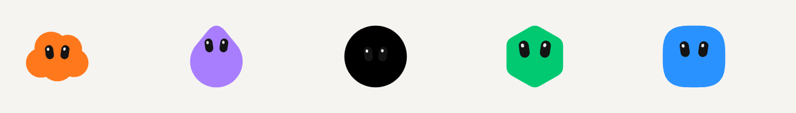

<p align="center">
  <picture>
    <source media="(prefers-color-scheme: dark)" srcset="assets/avatars-row-dark.png" />
    
  </picture>
</p>

<h1 align="center">grok-bot-avatar-engine</h1>

<p align="center"><strong>Grok Bot 头像引擎</strong></p>
<p align="center"><em>Agent id · 25 种形状 · 28 条动作片段 · SVG · 主 Bot 星标</em></p>
<p align="center"><a href="https://ronglecat.github.io/grok-bot-avatar-engine/zh/">https://ronglecat.github.io/grok-bot-avatar-engine/zh/</a></p>

<p align="center">
  <a href="./README_ZH.md">中文</a> ·
  <a href="./README.md">English</a>
</p>

<p align="center">
  <a href="https://ronglecat.github.io/grok-bot-avatar-engine/zh/"></a>
  <a href="LICENSE"></a>
  <a href="https://github.com/RongleCat/grok-bot-avatar-engine/stargazers"></a>
  
  
  
</p>

<p align="center">
  <a href="https://x.com/cgnot996"></a>
  
  <a href="https://bot.tiezhu.si/"></a>
</p>

<p align="center">
  
  &nbsp;&nbsp;
  
</p>

<p align="center"><sub>左：微信公众号 <strong>铁柱AGI</strong>。右：作者个人微信。付费社群需要邀请，加上这个微信后再申请。</sub></p>

---

> [!NOTE]
> **关于这个引擎。** grok-bot-avatar-engine 用 SVG 画 Grok Bot 的角色：agent id 的算法、轮廓、眼位、28 条动作片段，以及主 Bot 的星标。它是 [铁柱AGI](https://x.com/cgnot996) 的独立库。**不是 xAI 的产品，不是 Cursor 的产品，也不是 Grok Bot 应用本身。**
>
> 同一位作者还做了 [Grok App](https://github.com/RongleCat/grok-app)（本机 Grok Build CLI 的桌面工作台）和 [grok-bot-sdk](https://github.com/RongleCat/grok-bot-sdk)（协议客户端）。它们是不同的程序。

---

## 安装

Node.js **22.13 或更新**。只有 ESM。运行时没有 npm 依赖。

```sh
npm install github:RongleCat/grok-bot-avatar-engine
```

```js
import { resolveAvatar, renderAvatarSvg, createAvatar } from 'grok-bot-avatar-engine';

const avatar = resolveAvatar('33cf1aae-3a51-452d-b761-34a6ccb62201');
// cloud，brown

document.querySelector('#bot').innerHTML = renderAvatarSvg({
  agentId: avatar.agentId,
  state: 'working',
  time: 1.2,
  size: 96,
  main: true,
});
```

`main: true` 会把橙色星星嵌进轮廓。圆盘在 60 的 viewBox 里直径是 16，孔比圆盘再大 2.7。改 `size` 不会改这些比例。

在浏览器里，`createAvatar(element, options)` 用 `requestAnimationFrame` 播放片段。`setState('finished')` 会重新计时。

```sh
node examples/preview.mjs
```

打开 `http://127.0.0.1:4174`。

## 和 Grok Bot 0.70.2 对齐的部分

- id 字符串按 UTF-16 哈希，连字符和大小写保持原样。全大写是另一个角色。黑色只能显式指定。
- `avatarShape` 和 `avatarColor` 各自覆盖一个字段。有图片地址时改画图片。
- 22 条轮廓路径和那个客户端的轮廓构建器一致，包括云、心、闪光、盾牌和六角星。
- 眼表用的是同一组设计比例。六边形是基准胶囊。
- 状态表和 28 条片段是同一份，包括 blocked 停留 120 秒，以及小于 48px 时闲置只用紧凑片段。
- 星星的颜色是 `#f59312`。

桌面客户端随后把这些轮廓做成旋转体、放样或挤出网格。这个包画的是 SVG 正面。正对你的静止角色，剪影相同。大角度偏航在这里是压扁，在网格里是转向。blob 是球体的正面圆。crystal 是那组小球的十四个分开的圆。flower 是客户端拿去挤出的六瓣并集。

## 文档

指南和接口，中英两份：

- 中文：https://ronglecat.github.io/grok-bot-avatar-engine/zh/
- English：https://ronglecat.github.io/grok-bot-avatar-engine/

```sh
npm install
npm test
npm run docs:dev
```

## 相关项目

| 项目 | 是什么 |
|---|---|
| [grok-bot-sdk](https://github.com/RongleCat/grok-bot-sdk) | Grok Bot 0.70.2 桌面协议的客户端。它算出头像参数，不负责画。 |
| [Grok App](https://github.com/RongleCat/grok-app) | 本机 Grok Build CLI 的开源桌面工作台。[grok-app.com](https://grok-app.com) |
| [awesome-grok-bot](https://github.com/RongleCat/awesome-grok-bot) | Grok Bot 社区索引 |
| [Grok Bot 学习站](https://bot.tiezhu.si/) | 从安装到组一个 bot 团队：例程、案例、用法 |

## 作者和社区

| 渠道 | 哪里 |
|---|---|
| X | [@cgnot996（铁柱AGI）](https://x.com/cgnot996) |
| 微信公众号 | 搜索 **铁柱AGI**，或扫上面左边的码 |
| 付费社群 | 扫右边的码加上作者微信，再申请加入 |
| 学习站 | [bot.tiezhu.si](https://bot.tiezhu.si/) |

页首那一排是这个包自己画的：橙色的云、紫色的水滴、黑色的圆、绿色的六边形、蓝色的方圆。它不是 xAI 的标志。

MIT 许可证。Copyright 2026 RongleCat.
